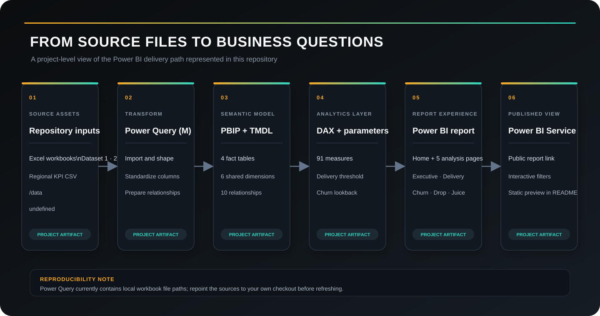
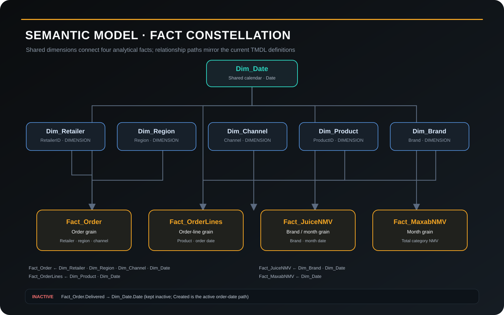

# FMCG Sales & Retailer Lifecycle Analytics
<div align="center">

### Power BI · DAX · Power Query · TMDL · Business Intelligence

**A portfolio analytics scenario exploring retailer sales, delivery performance, retention, and category movement in an Egyptian B2B distribution context.**

[**Explore the live dashboard ↗**](https://sohila-khaled-abbas.vercel.app/dashboards/fmcg-sales-churn-drop-analysis-powerbi/#story-result) · [Open interactive report in Power BI ↗](https://app.powerbi.com/view?r=eyJrIjoiNzE0MWUwYTgtZTlhZC00N2IxLWFmYzQtYmI2MzFkNjFhN2NjIiwidCI6IjI1Y2UwMjYxLWJiZDYtNDljZC1hMWUyLTU0MjYwODg2ZDE1OSJ9) · [Browse source files](https://github.com/Sohila-Khaled-Abbas/fmcg-sales-churn-drop-analysis-powerbi)


</div>

---

## Dashboard preview

<a href="https://app.powerbi.com/view?r=eyJrIjoiNzE0MWUwYTgtZTlhZC00N2IxLWFmYzQtYmI2MzFkNjFhN2NjIiwidCI6IjI1Y2UwMjYxLWJiZDYtNDljZC1hMWUyLTU0MjYwODg2ZDE1OSJ9">
  
</a>

<sub>Published report preview. Select the image or use the links above to open the interactive Power BI report. The static preview is an image; report interactions are available in Power BI.</sub>

> **Portfolio scope:** This is an independent portfolio scenario. The Maxab name is used to describe the business context represented in the project materials; this repository does not establish client engagement, endorsement, or affiliation. Business benefits are analytical objectives, not measured outcomes.

## At a glance

| Area | Current implementation |
|---|---|
| Reporting | 6 pages: Home + 5 analytical views |
| Semantic model | PBIP project with TMDL definitions |
| Analytical facts | 4 fact tables |
| Shared dimensions | 6 dimensions |
| Relationships | 10 defined relationships; 1 inactive |
| DAX library | 91 measures in the current MeasureLibrary definition |
| Transformations | Power Query (M), Import-mode partitions |
| Report delivery | Published Power BI report + repository source artifacts |
| Main analysis period | 2024, with May 2024 weekly drop analysis |

## Business questions

The report is organized around practical questions that a commercial, operations, or retention team could investigate:

- **Performance:** How are sales, orders, active retailers, average order value, and order success moving over time?
- **Delivery:** How does delivery performance compare with a configurable working-day threshold, and where are delays concentrated?
- **Retailer lifecycle:** Which retailers are activating, remaining active, or becoming inactive under a configurable churn lookback?
- **Sales drop:** What changed between May 2024 weeks, and which products or SKUs contributed to the movement?
- **Commercial mix:** How does the juice category contribute to total NMV, and how is value distributed across brands?

## Explore the report pages

The repository includes authored SVG page-layout assets. These are **design/layout previews**, not screenshots of the live report.

| Page | Analytical focus | Layout preview |
|---|---|---|
| 00 · Home | Navigation and high-level context | [Open SVG](assets/Maxab_P1_Executive_Overview.svg) |
| 01 · Executive Overview | Sales, orders, retailer and regional performance | [Open SVG](assets/Maxab_P1_Executive_Overview_1.svg) |
| 02 · Performance & Delivery | Delivery success, delays and SLA analysis | [Open SVG](assets/Maxab_P2_Performance_Delivery.svg) |
| 03 · Churn & Activation | Activation, churn and cohort retention | [Open SVG](assets/Maxab_P3_Churn_Activation.svg) |
| 04 · Drop Analysis | May weekly sales movement and SKU-level drops | [Open SVG](assets/Maxab_P4_Drop_Analysis.svg) |
| 05 · Commercial — Juice | Juice NMV and brand contribution | [Open SVG](assets/Maxab_P5_Commercial_Juice.svg) |

## Architecture

### Analytics delivery path



The repository contains source workbooks and a regional KPI CSV, Power Query transformations, a TMDL semantic model, a DAX measure library, report definitions, and the published Power BI report.

### Semantic model



**Fact tables**

| Table | Analytical grain / purpose |
|---|---|
| `Fact_Order` | Order-level sales, retailer, status, delivery, region and channel |
| `Fact_OrderLines` | Order-line product and sales detail |
| `Fact_JuiceNMV` | Monthly juice category sales by brand |
| `Fact_MaxabNMV` | Monthly total NMV reference |

**Dimensions**

| Dimension | Role |
|---|---|
| `Dim_Date` | Calendar, month, week, working-day and holiday attributes |
| `Dim_Retailer` | Retailer lookup |
| `Dim_Region` | Geographic grouping |
| `Dim_Channel` | Channel grouping |
| `Dim_Product` | Product, SKU and category attributes |
| `Dim_Brand` | Brand lookup for juice analysis |

The current relationship definition contains 10 relationships. The `Fact_Order.Delivered → Dim_Date.Date` relationship is inactive; the order-created date is the active order-date path. Review [relationships.tmdl](src/Maxab%20Retail%20Performance%20%26%20Churn%20Analytics%20Dashboard.SemanticModel/definition/relationships.tmdl).

## Analytical layer

The current `MeasureLibrary.tmdl` contains **91 DAX measure definitions**, organized into display folders.

| Measure group | Examples |
|---|---|
| Performance KPIs | Total Sales, Total Orders, Total Retailers, AOV, Frequency |
| Success & Fail | Orders Success, Orders Fail, Success Rate % |
| Churn & Activation | Active Retailers, Churned Retailers, Churn Rate %, Activation Retailers |
| Delivery & SLA | Delivery SLA (Working Days), SLA Status, Delay Rate % |
| Drop analysis | Weekly Sales, Drop % vs Prior Week, SKU Drop Delta % |
| Commercial / Juice | Total NMV, Juice NMV, Juice Share %, Brand Share % |
| Period comparisons | YTD, prior-month and MoM measures |
| Presentation logic | Tooltips, page subtitles, conditional-formatting colors and home-page labels |

Two what-if parameter tables support interactive analysis:

- `DeliveryThresholdDays`: working-day threshold values from 1 to 7; the measure fallback is 2.
- `ChurnLookbackMonths`: lookback values from 1 to 6 months; the measure fallback is 3.

Sources: [MeasureLibrary.tmdl](src/Maxab%20Retail%20Performance%20%26%20Churn%20Analytics%20Dashboard.SemanticModel/definition/tables/MeasureLibrary.tmdl) · [DeliveryThresholdDays.tmdl](src/Maxab%20Retail%20Performance%20%26%20Churn%20Analytics%20Dashboard.SemanticModel/definition/tables/DeliveryThresholdDays.tmdl) · [ChurnLookbackMonths.tmdl](src/Maxab%20Retail%20Performance%20%26%20Churn%20Analytics%20Dashboard.SemanticModel/definition/tables/ChurnLookbackMonths.tmdl)

## Design system

The Power BI theme is defined in [maxab-theme.json](themes/maxab-theme.json). It uses a dark canvas with amber and teal accents, supported by blue, green, red and violet chart colors.

| Token | Value | Use |
|---|---|---|
| Canvas | `#0B0D0F` | Report background |
| Surface | `#111418` | Visual containers |
| Amber | `#F5A623` | Primary emphasis |
| Teal | `#2DD4BF` | Secondary emphasis |
| Blue | `#60A5FA` | Supporting series |
| Text | `#C8CDD4` | Main text |
| Muted | `#5A6370` | Labels and secondary text |

The theme references DM Sans, Syne, and IBM Plex Mono for a clear hierarchy across headings, KPIs, and labels.

## Repository map

```text
.
├── assets/                 # SVG page-layout previews
├── dashboards/             # PBIX and PDF report exports
├── data/                   # Source workbooks and KPI CSV
├── dax/                    # DAX query / utility files
├── design/                 # HTML wireframe and PowerPoint designs
├── docs/
│   └── diagrams/           # Analytics architecture and model diagrams
├── src/
│   ├── *.pbip               # Power BI Project entry point
│   ├── *.Report/            # Report pages, visuals, bookmarks, resources
│   └── *.SemanticModel/     # TMDL model, tables, relationships and measures
└── themes/                 # Power BI theme JSON
```

Useful entry points:

- [Open the PBIP project](src/Maxab%20Retail%20Performance%20%26%20Churn%20Analytics%20Dashboard.pbip)
- [Open the PBIX dashboard](dashboards/Maxab%20Retail%20Performance%20%26%20Churn%20Analytics%20Dashboard.pbix)
- [Open the PDF report export](dashboards/Maxab%20Retail%20Performance%20%26%20Churn%20Analytics%20Dashboard.pdf)
- [Open the HTML dashboard wireframe](design/maxab-dashboard-wireframe.html)
- [Browse DAX queries](src/Maxab%20Retail%20Performance%20%26%20Churn%20Analytics%20Dashboard.SemanticModel/DAXQueries/)

## Run the project locally

### Prerequisites

- Power BI Desktop with PBIP/TMDL project support
- Access to the source workbook files included under `data/`
- The fonts referenced by the theme (optional, for closer visual parity)

### Open the project

1. Clone or download this repository.
2. Open the `.pbip` file under `src/` in Power BI Desktop.
3. If prompted, review the Power Query source steps and repoint each workbook path to the matching files in your local `data/` directory.
4. Apply the theme from `themes/maxab-theme.json` if it is not already applied.
5. Refresh the model and resolve any local path, credential, or schema prompts.
6. Explore the report pages and validate the slicers and measures.

### Important: source paths

The current Power Query definitions include local Windows `File.Contents(...)` paths from the original authoring environment. A fresh clone should **not** be expected to refresh without updating those paths. Replace them with paths valid on your machine (or parameterize the sources) before refreshing. The report's published Power BI view is separate from your local refresh configuration.

## Evidence & project files

- [Power BI Project source](src/Maxab%20Retail%20Performance%20%26%20Churn%20Analytics%20Dashboard.pbip)
- [Semantic model definitions](src/Maxab%20Retail%20Performance%20%26%20Churn%20Analytics%20Dashboard.SemanticModel/definition/)
- [Report page definitions](src/Maxab%20Retail%20Performance%20%26%20Churn%20Analytics%20Dashboard.Report/definition/pages/)
- [DAX query examples](src/Maxab%20Retail%20Performance%20%26%20Churn%20Analytics%20Dashboard.SemanticModel/DAXQueries/)
- [Dashboard design wireframe](design/maxab-dashboard-wireframe.html)
- [Published portfolio case study](https://sohila-khaled-abbas.vercel.app/dashboards/fmcg-sales-churn-drop-analysis-powerbi/#story-result)

## Notes on interpretation

- The analysis and source data represent a portfolio exercise, not a verified live operational feed.
- The presence of a public Power BI report does not imply that its underlying dataset refreshes in real time.
- Refresh frequency, service-level commitments, commercial impact, and client affiliation should only be stated when independently configured and evidenced.
- The May weekly sales analysis is defined around May 2024 in the current DAX measure library.

---

<div align="center">

**Built by [Sohila Khaled Abbas](https://sohila-khaled-abbas.vercel.app/)**

[Portfolio](https://sohila-khaled-abbas.vercel.app/) · [LinkedIn](https://linkedin.com/in/sohilakabbas) · [GitHub](https://github.com/Sohila-Khaled-Abbas)

*Thoughtful data. Useful things.*

</div>
